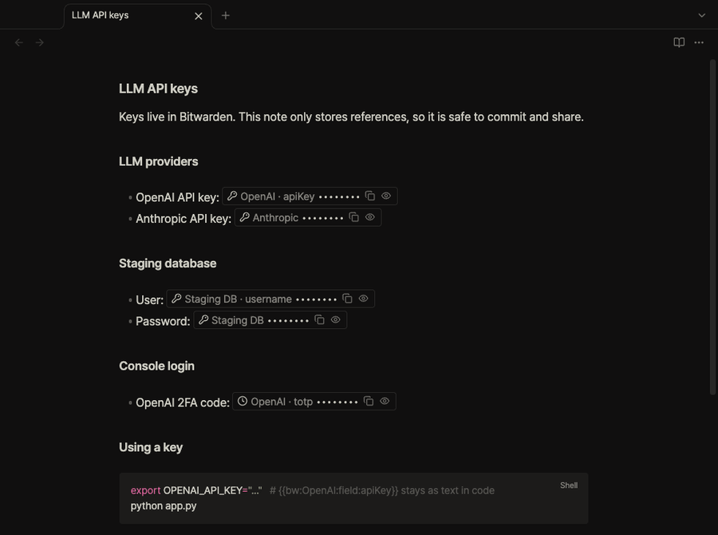
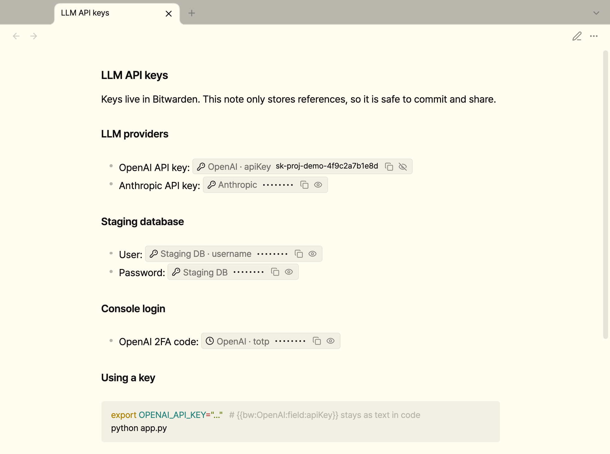
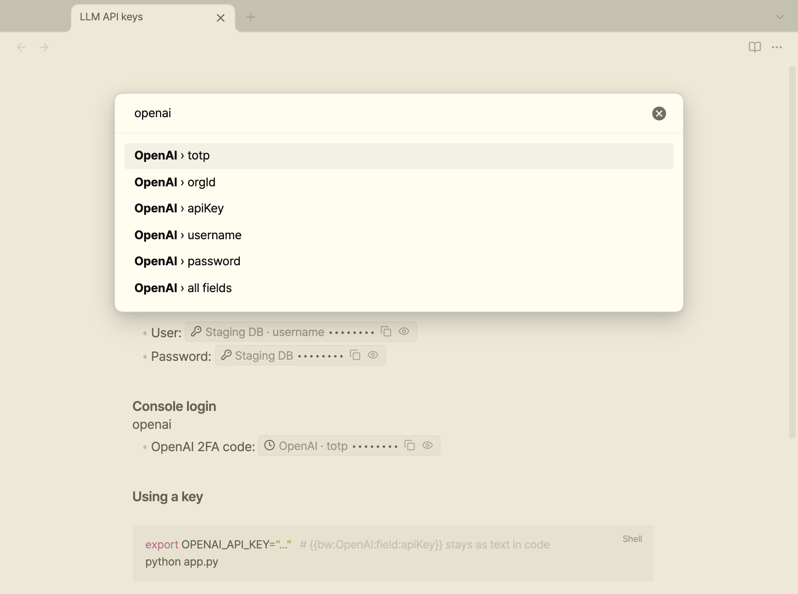
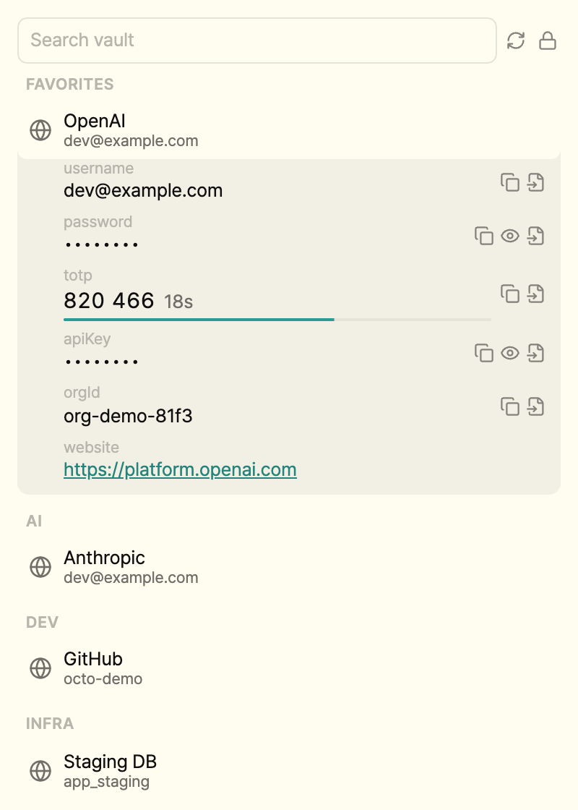
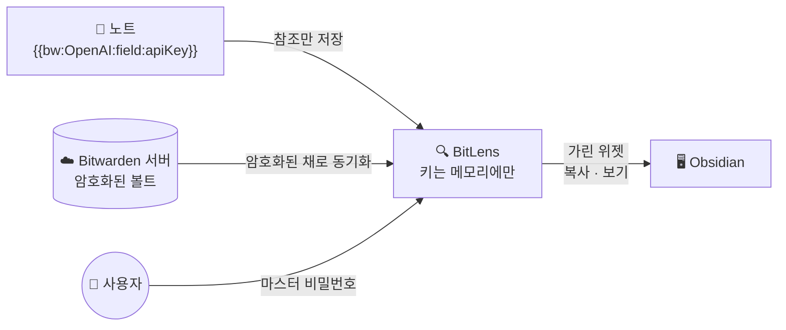

<a id="readme-top"></a>

<div align="center">


# BitLens

**노트에는 비밀 값 대신 참조만 남깁니다. Bitwarden® 아이템을 `{{bw:...}}`로 불러오면, 화면에서는 가려서 보여주고 복호화는 메모리 안에서만 합니다.**

Markdown 파일에는 참조 문자열만 저장됩니다. 노트를 동기화하거나 공유하거나 Git에 올려도 API 키와 비밀번호가 새지 않습니다.

[![CI][ci-shield]][ci-url] [![License][license-shield]][license-url] [![Obsidian][obsidian-shield]][obsidian-url] [![Local decryption][local-shield]][security-url]

[English](README.md) · **한국어**

[설치](#설치) · [사용법](#사용법) · [스크린샷](#스크린샷) · [동작 방식](#동작-방식) · [개인정보와 보안](#개인정보와-보안) · [제약 사항](#제약-사항)

<br>



<sub>값 보기 → 복사(30초 뒤 클립보드 삭제) → <code>{{bw:</code> 입력으로 참조 삽입 (가짜 예시 데이터)</sub>

</div>

> [!NOTE]
> BitLens는 독립적으로 만든 비공식 플러그인입니다. Bitwarden, Inc.와 관계가 없으며 Bitwarden의 보증을 받지 않았습니다.

## 왜 BitLens인가

- 🔒 **비밀 정보는 디스크에 남지 않습니다.** 마스터 비밀번호, 파생 키, 액세스 토큰, 복호화한 볼트는 메모리에만 있고 잠그는 순간 지워집니다.
- 📝 **노트를 마음껏 공유할 수 있습니다.** 노트에는 키 자체가 아니라 `{{bw:OpenAI:field:apiKey}}`만 적힙니다. 커밋하든 동기화하든 게시하든 안전합니다.
- 👁 **요청할 때만 보입니다.** 비밀 값은 읽기 화면과 Live Preview에서 `•••••••• [복사] [보기]` 위젯으로 나타납니다. 값은 버튼을 누르는 순간에만 꺼냅니다.
- ⏱ **알아서 잠깁니다.** 일정 시간 입력이 없으면 볼트가 잠기고, 복사한 값은 30초 뒤 클립보드에서 지워집니다.
- 🧪 **Bitwarden 공식 테스트 벡터로 검증했습니다.** 복호화는 Bitwarden 클라이언트 프로토콜을 따르고, Bitwarden 공식 SDK의 테스트 벡터로 결과를 확인합니다.

## 기능

- **인라인 시크릿 위젯**: 읽기 화면과 Live Preview에서 복사, 보기, 실시간 TOTP 코드를 지원합니다. 커서를 위젯 안으로 옮기면 원래 참조 문자열을 고칠 수 있습니다.
- **문법을 외울 필요 없는 삽입**: **Insert secret reference** 명령으로 필드 하나 또는 아이템 전체를 목록 형태로 넣습니다. `{{bw:`까지 치면 자동완성도 뜹니다.
- **볼트 사이드바**: 이름·사용자명·URL 검색, 즐겨찾기와 폴더 묶음, 필드별 복사·보기·삽입, 남은 시간이 표시되는 TOTP 코드를 제공합니다.
- **상태 표시줄 잠금 버튼**과 **Unlock / Lock / Sync** 명령을 제공합니다.
- **Bitwarden 클라우드(US, EU)와 셀프 호스팅 서버**, 개인 아이템과 조직 아이템을 모두 지원합니다.

## 스크린샷

<picture>
  <source media="(prefers-color-scheme: dark)" srcset="docs/images/note-dark.png">
  
</picture>

<p align="center"><b>노트</b> — 참조가 가린 위젯으로 바뀌고, 필요할 때만 보거나 복사</p>

<table>
  <tr>
    <td width="62%" valign="top">
      <picture>
        <source media="(prefers-color-scheme: dark)" srcset="docs/images/insert-dark.png">
        
      </picture>
      <p align="center"><b>삽입</b> — 필드 하나나 아이템 전체를 골라 넣기, 문법 몰라도 됨</p>
    </td>
    <td width="38%" valign="top">
      <picture>
        <source media="(prefers-color-scheme: dark)" srcset="docs/images/sidebar-dark.png">
        
      </picture>
      <p align="center"><b>사이드바</b> — 둘러보기, 복사, 삽입, 실시간 TOTP</p>
    </td>
  </tr>
</table>

> 스크린샷과 데모는 가짜 예시 데이터를 사용합니다.

## 동작 방식



1. BitLens가 개인 API 키로 로그인해 **암호화된** 볼트를 내려받습니다.
2. 마스터 비밀번호로 키를 만들어 볼트를 **내 컴퓨터에서** 복호화합니다. 비밀번호는 저장하거나 전송하지 않습니다.
3. 노트의 `{{bw:...}}`는 가린 위젯으로 바뀌어 보입니다. 노트 파일 자체는 바뀌지 않습니다.

## 설치

아직 커뮤니티 플러그인 목록에는 없어서 직접 설치해야 합니다. 데스크톱에서만 동작합니다.

1. [최신 릴리스][release-url]에서 `main.js`, `manifest.json`, `styles.css`를 받습니다.
2. 세 파일을 `<볼트 경로>/.obsidian/plugins/bitlens/`에 넣습니다.
3. Obsidian을 다시 불러온 뒤 **설정 → 커뮤니티 플러그인**에서 **BitLens**를 켭니다.

**필요 조건:** 데스크톱용 Obsidian 1.11.4 이상, Bitwarden 계정

## 사용법

### 1. 계정 연결

1. Bitwarden 웹 볼트에서 **설정 → 보안 → 키 → API 키 보기**를 열고 `client_id`와 `client_secret`을 확인합니다.
2. Obsidian에서 **설정 → BitLens**를 열고 서버, 이메일, `client_id`, `client_secret`을 입력합니다.
3. 상태 표시줄의 **🔒 Bitwarden**을 누르거나 **Unlock vault** 명령을 실행한 뒤 마스터 비밀번호를 입력합니다.

### 2. 비밀 값 참조하기

**Insert secret reference** 명령을 실행하거나 `{{bw:`를 입력하고 필드를 고릅니다. **OpenAI › all fields**를 고르면 다음 내용이 들어갑니다.

```markdown
- username: {{bw:OpenAI:username}}
- password: {{bw:OpenAI:password}}
- totp: {{bw:OpenAI:totp}}
- apiKey: {{bw:OpenAI:field:apiKey}}
```

### 참조 문법

| 참조 | 가져오는 값 |
| --- | --- |
| `{{bw:Item}}` | 비밀번호 |
| `{{bw:Item:username}}` | 사용자명 |
| `{{bw:Item:password}}` | 비밀번호 |
| `{{bw:Item:totp}}` | 현재 TOTP 코드 |
| `{{bw:Item:notes}}` | 메모 |
| `{{bw:Item:field:Name}}` | 커스텀 필드 `Name` |

`Item`은 Bitwarden의 아이템 이름이고, 같은 이름의 아이템이 둘 이상 있으면 안 됩니다. 인라인 코드와 코드 블록 안의 참조는 글자 그대로 둡니다. 그래서 노트에 문법 예시를 적어 둘 수 있습니다.

> [!TIP]
> API 키를 Bitwarden에 가장 빨리 넣는 방법은 로그인 아이템의 **비밀번호** 칸에 키를 넣는 것입니다. 그러면 노트에는 `{{bw:OpenAI}}`만 쓰면 됩니다.

## 개인정보와 보안

| 데이터 | 저장 위치 |
| --- | --- |
| 마스터 비밀번호 | 언락 창에 입력해 키를 만들 때 한 번만 사용. 저장·전송하지 않음 |
| 키, 액세스 토큰, 복호화한 볼트 | 메모리에만 존재. 잠금, 자동 잠금, Obsidian 종료 시 삭제 |
| `client_secret` | Obsidian 시크릿 저장소. 볼트 폴더 밖에 있고 OS 키체인으로 암호화 |
| 설정 | 플러그인의 `data.json`. 서버, 이메일, `client_id`, 시크릿 이름, 기기 ID, 자동 잠금 시간만 저장. 민감 정보 없음 |
| 노트 | `{{bw:...}}` 참조만 저장. BitLens가 스스로 노트를 수정하지 않음 |
| 네트워크 | 설정한 Bitwarden 서버(bitwarden.com, bitwarden.eu, 셀프 호스팅)에만 연결. 텔레메트리 없음 |

복호화는 Bitwarden 클라이언트 프로토콜을 따릅니다. PBKDF2-SHA256 또는 Argon2id, HKDF, AES-256-CBC와 HMAC-SHA256, 조직 키용 RSA-OAEP를 씁니다. 공식 클라이언트와 마찬가지로 MAC 검증을 통과하지 못한 암호문은 거부합니다.

> [!IMPORTANT]
> **네트워크 사용과 계정:** BitLens를 쓰려면 Bitwarden 계정이 필요합니다. BitLens는 키 파생 설정 확인, 개인 API 키 로그인, 암호화된 볼트 다운로드를 위해 설정한 Bitwarden 서버에만 접속합니다.

## 제약 사항

- **읽기 전용:** 아이템 생성과 수정은 Bitwarden에서 해야 합니다.
- **데스크톱 전용:** 모바일은 아직 지원하지 않습니다.
- **Bitwarden의 새 암호화 방식(v2) 미지원:** 해당 계정은 언락할 때 원인을 알려주는 오류가 나타납니다.
- **읽기 화면:** 아이템 이름에 Markdown 강조 문자(`*`, `_`)가 있으면 인식하지 못합니다.
- **사이드바:** 로그인, 메모, 커스텀 필드만 표시합니다. 카드, 신원, SSH 키의 상세 정보는 보여주지 않습니다.

## 개발

```bash
npm install
npm test        # Bitwarden SDK 테스트 벡터를 포함한 단위 테스트
npm run build   # 타입 검사 후 main.js로 번들링
```

빌드 결과를 확인하려면 `main.js`, `manifest.json`, `styles.css`를 `<볼트 경로>/.obsidian/plugins/bitlens/`에 복사합니다. `manifest.json`의 버전과 같은 태그를 push하면 릴리스 초안이 만들어집니다.

Argon2id와 HKDF는 [@noble/hashes](https://github.com/paulmillr/noble-hashes)를 사용합니다.

## 라이선스

[MIT](LICENSE)

<p align="right"><a href="#readme-top">맨 위로 ↑</a></p>

---

<sub>Bitwarden은 미국 및 기타 국가에서 Bitwarden, Inc.의 상표 또는 등록 상표입니다.</sub>

[ci-shield]: https://img.shields.io/github/actions/workflow/status/sjoon21/bitlens/ci.yml?branch=main&style=for-the-badge&label=CI
[ci-url]: https://github.com/sjoon21/bitlens/actions/workflows/ci.yml
[license-shield]: https://img.shields.io/badge/license-MIT-blue?style=for-the-badge
[license-url]: LICENSE
[obsidian-shield]: https://img.shields.io/badge/Obsidian-1.11.4%2B_desktop-7C3AED?style=for-the-badge&logo=obsidian&logoColor=white
[obsidian-url]: https://obsidian.md
[local-shield]: https://img.shields.io/badge/decryption-local_%26_in--memory-2ea44f?style=for-the-badge
[security-url]: #개인정보와-보안
[release-url]: https://github.com/sjoon21/bitlens/releases/latest
