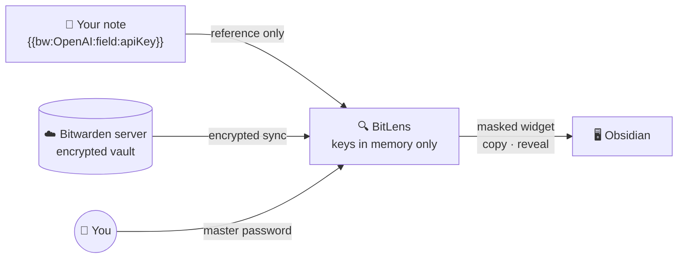

<a id="readme-top"></a>

<div align="center">


# BitLens

**Keep secrets out of your notes. Reference Bitwarden® items with `{{bw:...}}` and see them through a lens: masked in place, decrypted only in memory.**

Your Markdown files only ever contain the reference, so notes can be synced, shared or pushed to Git without leaking API keys or passwords.

[![CI][ci-shield]][ci-url] [![License][license-shield]][license-url] [![Obsidian][obsidian-shield]][obsidian-url] [![Local decryption][local-shield]][security-url]

**English** · [한국어](README.ko.md)

[Install](#install) · [Usage](#usage) · [How it works](#how-it-works) · [Privacy & security](#privacy--security) · [Limitations](#limitations)

</div>

> [!NOTE]
> BitLens is an independent, unofficial plugin. It is not affiliated with or endorsed by Bitwarden, Inc.

## Why BitLens

- 🔒 **Nothing secret touches the disk.** Your master password, the derived keys, the access token and the decrypted vault live only in memory and are wiped when the vault locks.
- 📝 **Notes stay shareable.** A note says `{{bw:OpenAI:field:apiKey}}`, never the key itself. Commit it, sync it, publish it.
- 👁 **Masked until you ask.** Secrets render as `•••••••• [copy] [show]` widgets in Reading view and Live Preview. A value is looked up only at the moment you click.
- ⏱ **Locks itself.** An idle timer locks the vault, and copied values are cleared from the clipboard after 30 seconds.
- 🧪 **Checked against Bitwarden's own test vectors.** Decryption follows Bitwarden's client protocol and is tested with vectors from Bitwarden's official SDK.

## Features

- **Inline secret widgets** in Reading view and Live Preview: copy, reveal, and live TOTP codes. Move the cursor into a widget to edit the raw reference.
- **Insert without typing the syntax**: run **Insert secret reference** to pick one field or a whole item as a ready-made list, or type `{{bw:` for autocomplete.
- **Vault sidebar**: search by name, username or URL, favorites and folders, per-field copy / reveal / insert, and TOTP codes with a countdown.
- **Status bar lock** and **Unlock / Lock / Sync** commands.
- **Bitwarden cloud (US, EU) and self-hosted servers**, personal and organization items.

## How it works



1. BitLens logs in with your personal API key and downloads your **encrypted** vault.
2. Your master password derives the keys that decrypt it **locally**. The password itself is never stored or sent.
3. Every `{{bw:...}}` in a note becomes a masked widget. The note file is never changed.

## Install

BitLens is not in the Community plugins directory yet. Install it manually (desktop only):

1. Download `main.js`, `manifest.json` and `styles.css` from the [latest release][release-url].
2. Put them in `<your vault>/.obsidian/plugins/bitlens/`.
3. Reload Obsidian and enable **BitLens** in **Settings → Community plugins**.

**Requirements:** Obsidian 1.11.4 or later on desktop, and a Bitwarden account.

## Usage

### 1. Connect your account

1. In the Bitwarden web vault, open **Settings → Security → Keys → View API key** and note `client_id` and `client_secret`.
2. In Obsidian, open **Settings → BitLens** and fill in the server, your email, `client_id` and `client_secret`.
3. Click **🔒 Bitwarden** in the status bar, or run **Unlock vault**, and enter your master password.

### 2. Reference a secret

Run **Insert secret reference** (or type `{{bw:`) and pick a field. Choosing **OpenAI › all fields** inserts:

```markdown
- username: {{bw:OpenAI:username}}
- password: {{bw:OpenAI:password}}
- totp: {{bw:OpenAI:totp}}
- apiKey: {{bw:OpenAI:field:apiKey}}
```

### Reference syntax

| Reference | Value |
| --- | --- |
| `{{bw:Item}}` | password |
| `{{bw:Item:username}}` | username |
| `{{bw:Item:password}}` | password |
| `{{bw:Item:totp}}` | current TOTP code |
| `{{bw:Item:notes}}` | notes |
| `{{bw:Item:field:Name}}` | custom field `Name` |

`Item` is the item's name in Bitwarden and must be unique. References inside code spans and code blocks stay as text, so you can document the syntax.

> [!TIP]
> The quickest way to store an API key in Bitwarden is a Login item with the key in its **password** field. Then `{{bw:OpenAI}}` is all you need.

## Privacy & security

| Data | Where it lives |
| --- | --- |
| Master password | Typed into the unlock dialog and used once to derive keys. Never stored or sent. |
| Keys, access token, decrypted vault | Memory only. Wiped on lock, on idle timeout and when Obsidian quits. |
| `client_secret` | Obsidian's secret storage: outside your vault folder, encrypted by the OS keychain. |
| Settings | The plugin's `data.json`: server, email, `client_id`, the secret's name, a device id, auto-lock time. Nothing sensitive. |
| Your notes | Only `{{bw:...}}` references. BitLens never writes to your notes on its own. |
| Network | Only the Bitwarden server you configure (bitwarden.com, bitwarden.eu or self-hosted). No telemetry. |

Decryption follows Bitwarden's client protocol: PBKDF2-SHA256 or Argon2id, HKDF, AES-256-CBC with HMAC-SHA256, and RSA-OAEP for organization keys. Like the official clients, BitLens rejects ciphertext without a valid MAC.

> [!IMPORTANT]
> **Network use and account:** BitLens requires a Bitwarden account. It contacts only your Bitwarden server, to read your key derivation settings, log in with your personal API key and download your encrypted vault.

## Limitations

- **Read-only:** create and edit items in Bitwarden itself.
- **Desktop only** for now.
- **Bitwarden's newer (v2) encryption** is not supported yet. Unlocking such an account shows a clear error.
- **Reading view:** item names containing Markdown emphasis characters (`*`, `_`) are not recognized.
- **Sidebar:** shows logins, notes and custom fields. Card, identity and SSH key details are not displayed.

## Development

```bash
npm install
npm test        # unit tests, including Bitwarden SDK test vectors
npm run build   # type check + bundle to main.js
```

Copy `main.js`, `manifest.json` and `styles.css` into `<vault>/.obsidian/plugins/bitlens/` to try a build. Pushing a tag equal to the manifest version creates a draft release.

Argon2id and HKDF come from [@noble/hashes](https://github.com/paulmillr/noble-hashes).

## License

[MIT](LICENSE)

<p align="right"><a href="#readme-top">Back to top ↑</a></p>

---

<sub>Bitwarden is a trademark or registered trademark of Bitwarden, Inc. in the United States and/or other countries.</sub>

[ci-shield]: https://img.shields.io/github/actions/workflow/status/sjoon21/bitlens/ci.yml?branch=main&style=for-the-badge&label=CI
[ci-url]: https://github.com/sjoon21/bitlens/actions/workflows/ci.yml
[license-shield]: https://img.shields.io/badge/license-MIT-blue?style=for-the-badge
[license-url]: LICENSE
[obsidian-shield]: https://img.shields.io/badge/Obsidian-1.11.4%2B_desktop-7C3AED?style=for-the-badge&logo=obsidian&logoColor=white
[obsidian-url]: https://obsidian.md
[local-shield]: https://img.shields.io/badge/decryption-local_%26_in--memory-2ea44f?style=for-the-badge
[security-url]: #privacy--security
[release-url]: https://github.com/sjoon21/bitlens/releases/latest
